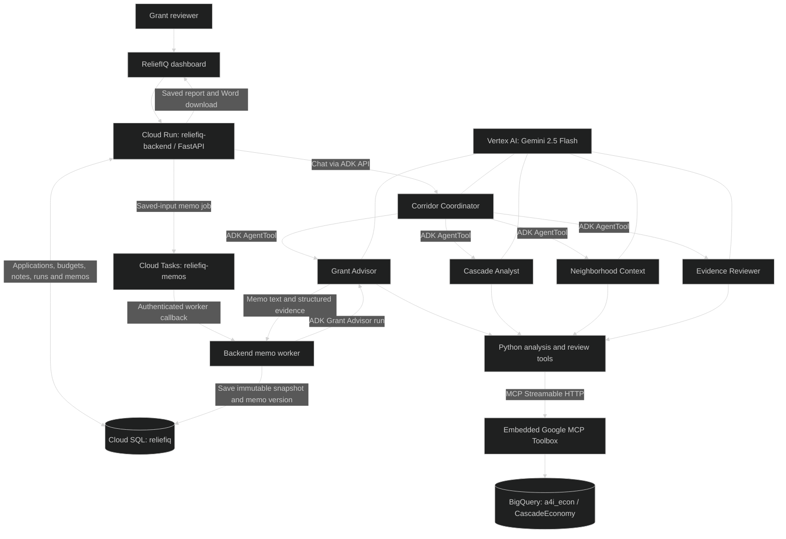
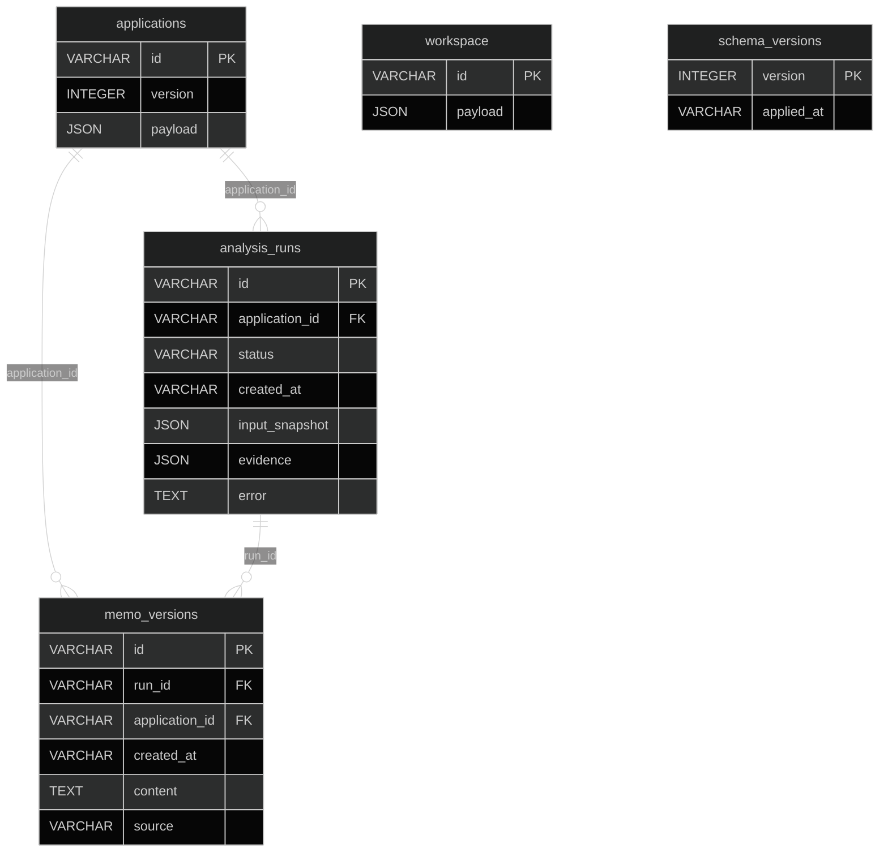
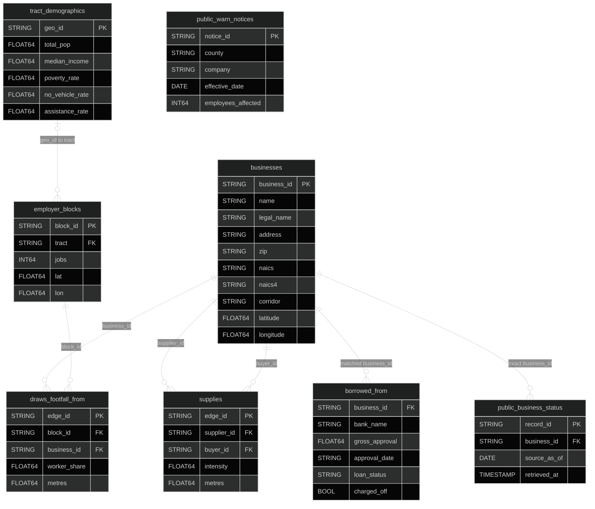

# ReliefIQ — Agents for Impact 2026

**Challenge 3: Community Economic Resilience & Micro-Grants · Track 1: Main Street Relief**

ReliefIQ helps grant reviewers decide where limited small-business relief funds can support a commercial corridor. It combines application inputs, modeled business dependencies, neighborhood context and public records to produce an explainable, conditional grant memo.

**[Open the submission dashboard](https://reliefiq-backend-89073885580.us-central1.run.app/)** · [Agent API](https://cascade-analyst-89073885580.us-central1.run.app/)

Our demonstration covers **Central Market, San Francisco**. The beneficiaries are small businesses, their workers and suppliers, neighborhood residents, and officers reviewing scarce relief funding. The goal is to make those decisions easier to inspect and explain, including the effects that extend beyond a single applicant.

## Use the submission

1. Open the dashboard and select **Quick Demo Login**. The shared challenge reviewer password is `demopassword`.
2. Select one of the eight applications. Inspect **Overview & Data**, **Application**, **Documents** and **Financials**.
3. Select **Edit financial inputs** to update the requested grant, cash gap, revenue or reviewer note; save the changes to the database.
4. Ask the review assistant a question. **Auto · Corridor Coordinator** routes it to the appropriate specialist; the selector also offers each agent directly.
5. Select **Generate Dashboard Memo**. The backend snapshots the saved inputs, queues the job and invokes Grant Advisor with live analytical evidence.
6. Read the resulting report, compare saved memo versions, or select **Download Word memo**. Reports remain available after refresh.
7. Use **Recommend [amount]** to record a human recommendation against the available budget. This records a recommendation; it does not approve or pay a grant.

The seeded pool is **$150,000 total**, **$100,000 committed** and **$50,000 available for the current round**. Each memo compares the selected application with up to five others, following the existing tool limit of two to six applicants. This is a shortlist comparison, not an optimization across all eight applications.

**Data provenance:** business identifiers connect to actual public registry records. Seeded owners, financials, document claims, UI scores and illustrated network connections are simulated. Live agent results use the loaded analytical tables; modeled relationships are not observed transactions or proven grant benefits.

## Deployed Google Cloud resources

Project: **`qwiklabs-gcp-04-029c15637557`** · Project number: **`89073885580`**. Cloud Run, Cloud SQL and Cloud Tasks use **`us-central1`**; BigQuery uses **`US`**; Vertex AI model requests use **`global`**.

Inventory and health checks were refreshed on **October 20, 2026**. These resources belong to the Qwiklabs project; availability depends on that project's lifetime.

| Resource | Deployed name / URL | Role and configuration |
|---|---|---|
| Cloud Run dashboard + backend | [`reliefiq-backend`](https://reliefiq-backend-89073885580.us-central1.run.app/) | Submission entry point. FastAPI serves the UI, database API, chat proxy, memo worker and Word export. Verified revision `reliefiq-backend-00001-8df`; 512 MiB, maximum 3 instances, 600-second timeout. |
| Cloud Run ADK agents | [`cascade-analyst`](https://cascade-analyst-89073885580.us-central1.run.app/) | Hosts all five agents and embedded Google MCP Toolbox. Verified revision `cascade-analyst-00008-wj4`; 2 CPUs, 2 GiB, concurrency 8, maximum 3 instances, 300-second timeout. |
| Cloud SQL PostgreSQL | [`reliefiq-db`](https://console.cloud.google.com/sql/instances/reliefiq-db/overview?project=qwiklabs-gcp-04-029c15637557) | PostgreSQL 15, `db-f1-micro`, 10 GB SSD, database `reliefiq`, database user `reliefiq`. Instance confirmed RUNNABLE. |
| BigQuery | [`a4i_econ`](https://console.cloud.google.com/bigquery?project=qwiklabs-gcp-04-029c15637557) | Eight submission data tables and the `CascadeEconomy` property graph. |
| Vertex AI | [Project console](https://console.cloud.google.com/vertex-ai?project=qwiklabs-gcp-04-029c15637557) | Gemini `gemini-2.5-flash` powers ADK reasoning and memo writing. These datasets inform tool calls; we did not fine-tune a model on them. |
| Cloud Tasks | [`reliefiq-memos`](https://console.cloud.google.com/cloudtasks?project=qwiklabs-gcp-04-029c15637557) | Durable memo requests. Queue path `projects/qwiklabs-gcp-04-029c15637557/locations/us-central1/queues/reliefiq-memos`; one concurrent dispatch, one attempt, explicit reviewer retry after failure. |
| Secret Manager | [`reliefiq-database-url`, `reliefiq-reviewer-password`](https://console.cloud.google.com/security/secret-manager?project=qwiklabs-gcp-04-029c15637557) | Backend receives `DATABASE_URL` and `REVIEWER_PASSWORD` through secret references. Database credentials are not sent to the browser. |
| Cloud Build / Artifact Registry | [Builds](https://console.cloud.google.com/cloud-build/builds?project=qwiklabs-gcp-04-029c15637557) · [Images](https://console.cloud.google.com/artifacts?project=qwiklabs-gcp-04-029c15637557) | Container build and image storage used by Cloud Run source deployments. |
| Cloud Logging | [Logs](https://console.cloud.google.com/logs/query?project=qwiklabs-gcp-04-029c15637557) | Runtime, deployment and worker diagnostics. Saved analysis evidence is also retained in PostgreSQL. |

The project also contains [`micro-grant-ui`](https://micro-grant-ui-89073885580.us-central1.run.app/) (latest observed revision `micro-grant-ui-00011-cpq`) and [`corridor-agent-san`](https://corridor-agent-san-7oo5tl7xpq-uc.a.run.app/) (`corridor-agent-san-00004-wdr`). These are separate project deployments; the verified submission workflow above uses `reliefiq-backend` and `cascade-analyst`. Use the submission entry point for persistent application and memo features.

### Runtime identities and connections

- Backend service account: `reliefiq-backend@qwiklabs-gcp-04-029c15637557.iam.gserviceaccount.com`, with Cloud SQL Client, Cloud Tasks Enqueuer and access to its two secrets.
- Agent service account: `cascade-analyst@qwiklabs-gcp-04-029c15637557.iam.gserviceaccount.com`, with BigQuery Job User, read access to `a4i_econ`, and Vertex AI User.
- Cloud SQL connection name: `qwiklabs-gcp-04-029c15637557:us-central1:reliefiq-db`; the backend connects through the Cloud SQL socket.
- Google MCP Toolbox runs inside the agent container at `http://127.0.0.1:5000`. It exposes fixed read-only BigQuery tools over MCP Streamable HTTP; this is an internal address.
- The dashboard uses a shared demo reviewer login and signed, HTTP-only cookies. The agent endpoint is public for this challenge deployment. Individual production reviewer authentication is outside this submission.

## Multi-agent and service blueprint

| Agent | Responsibility |
|---|---|
| **Corridor Coordinator** | Routes officer questions and returns specialist answers with structured evidence receipts. |
| **Cascade Analyst** | Traces supply disruption or reverse customer loss across up to two hops; reports named businesses, edge strengths and threshold sensitivity. |
| **Grant Advisor** | Compares budget-feasible interventions using supplied requests, cash gaps and operating assumptions; writes the seven-part grant memo. |
| **Neighborhood Context** | Adds tract demographics, modeled workplace footfall, dated registry status and county WARN notices. |
| **Evidence Reviewer** | Checks amounts, evidence consistency, provenance and unsupported claims; flags conditions requiring human review. |

Grant Advisor's comparison tool gathers specialist evidence through Python tools and performs a deterministic evidence review. Its allocation rule maximizes unique filtered modeled network exposure among full-gap-funded feasible portfolios, with cost as a tie-breaker. A request below the stated cash gap is infeasible under that assumption. The rule does not model causal effects, replacement suppliers, cultural value or a complete equity policy.

MCP is deployed for **data access**. Word report creation is implemented in the **backend**; the earlier MCP memo/report-service diagram represents a proposed extension, not the deployed export path.

### Memo contents and persistence

The generated report includes:

1. Recipient name, address, grant amount and unallocated budget.
2. Named cascade relationships and hop distances.
3. The GQL traversal and explicit path chains.
4. The recommended portfolio versus the runner-up and filter sensitivity.
5. Scenario provenance, operating horizon, assumptions and pre-approval evidence.
6. A distinction between measured, modeled and simulated evidence.
7. Neighborhood demographics and worker context, where available.

The backend saves the exact application versions, budget, shortlist and inputs before invoking the agent. It validates returned comparison inputs before saving a successful memo. Failed runs retain an error and create no successful report. Repeated active requests reuse a snapshot, workers claim jobs once, and interrupted runs can be marked failed after 30 minutes when their status is checked. Older reports retain their original snapshot and are flagged stale by the memo API after inputs change. ADK chat sessions are process-local; application records and memo versions are durable.

## Application database: PostgreSQL

Database **`reliefiq`** stores the workflow separately from BigQuery. The following is the implemented physical schema: financials, document metadata and notes are nested JSON fields, rather than separate relational tables. IDs are stored as strings; timestamps are ISO-8601 strings. Schema version **1** is recorded in `schema_versions`.

PostgreSQL enforces the shown application/run foreign keys. `workspace` is the single `default` workspace; its assignments and recommendations refer to application IDs inside JSON, without relational foreign keys. `schema_versions` is independent migration metadata.

### Application fields

| JSON field(s) in `applications.payload` | Meaning |
|---|---|
| `id`, `key`, `name`, `cat`, `address` | Business identifier, UI key, display name, category and seeded address. `applications.id` is the relational primary key. |
| `owner`, `since`, `staff`, `submitted` | Simulated owner, opening year, staff count and application submission label. |
| `ask`, `cash_gap`, `cash_gap_basis`, `use` | Requested grant and stated/assumed cash gap in USD, basis for the gap, and intended use of funds. |
| `status` | `ready`, `info`, `rev` or `new`. |
| `input_type`, `evidence_note`, `operating_assumption` | Provenance (`simulated` for the seed), evidence limitations and the assumed effect of full-gap funding. |
| `fin.appRev`, `fin.taxRev` | Simulated application and tax annual revenue, USD. |
| `fin.q` | Three quarterly revenue values; `null` denotes missing data. |
| `fin.staffFiled`, `fin.vendor`, `fin.quote` | Filed staffing description, vendor name and quote amount in USD. |
| `missing`, `notes` | Missing document keys and document/reviewer notes. Document keys: `app`, `tax`, `q1`, `q2`, `q3`, `lease`, `quote`. These are metadata and claims, not stored uploaded files. |
| `impact`, `parts` | Seeded preview score and component tuples: label, score, maximum and explanation. |
| `x`, `y`, `edges.out`, `edges.in`, `edges.spill` | Illustrated map position and simulated supplier/buyer/spillover connections. These differ from live BigQuery graph evidence. |

`applications.version` increments after an edit and prevents stale writes. The seed is [frontend/seed_data.json](frontend/seed_data.json); applying it again preserves existing reviewer edits.

### Workspace, run and report fields

| Record | Fields and meaning |
|---|---|
| `workspace.payload.settings` | `corridor`, `pool_total`, `pool_committed`, `round_budget`. |
| Other workspace payload fields | `nodes`, `documents`, `assignments`, `reviewer`, `notifications`, `activity`, and saved `recommendations` (`application_id → USD amount`). Seed notifications/activity are demonstration history. |
| `analysis_runs.status` | `queued`, `running`, `complete` or `failed`. |
| `analysis_runs.input_snapshot` | `selected_application_id`, `budget`, `horizon_days`, `application_versions`, full `applications`, and normalized `applicants`. Each normalized applicant includes `business_id`, `requested_amount`, `cash_gap`, `input_type`, `evidence_note`, `operating_assumption`. |
| `analysis_runs.evidence` | Structured comparison, cascade/public/neighborhood evidence, recommendation, alternatives, sensitivity and deterministic evidence review. Nullable until successful completion. |
| `analysis_runs.error` | Failure or recovery explanation; nullable on successful runs. |
| `memo_versions.content`, `source` | Saved generated memo text; source `live_grant_advisor`. `run_id` retrieves its original snapshot and evidence. |

The eight seeded cases are Steel + Lacquer, Orpheum Theatre, Sumfer Market Sf LLC, Pdm Group Inc, A & A Legal Service, Impark 0314, Blick Art Materials and 1010 Market LLC. Steel + Lacquer and Impark each request $15,000 while their seeded gap is $18,000; those values remain distinct.

## Analytical data: BigQuery

Dataset **`qwiklabs-gcp-04-029c15637557.a4i_econ`**. Row counts and fields below were read from BigQuery on October 20, 2026. Names in the diagram represent logical joins; they do not imply enforced BigQuery foreign keys.

`CascadeEconomy` is a property-graph overlay with `Business` nodes from `businesses` and directed `Supplies` edges from supplier to buyer. It does not duplicate table rows. Footfall and demographics are queried from tables. PostgreSQL application IDs logically match `businesses.business_id`; there is no cross-database enforced foreign key.

| Table | Rows | Source and use |
|---|---:|---|
| `businesses` | 232 | Actual San Francisco registered business locations and industry codes. |
| `supplies` | 994 | Modeled BEA industry-input requirements combined with proximity; not observed purchases. |
| `employer_blocks` | 122 | LEHD workplace job totals, with approximate coordinates derived from tract internal points. |
| `draws_footfall_from` | 1,024 | Modeled allocations of workplace workers to nearby consumer businesses; not measured visits. |
| `borrowed_from` | 4 | SBA loan records matched to business names/legal names. Recorded status is `EXEMPT`, with `charged_off=false`; matching is not independently verified and does not establish current distress. |
| `tract_demographics` | 7 | ACS population, income, poverty, no-vehicle and assistance estimates. |
| `public_business_status` | 4,571 | Dated Central Market registry history; exact-ID matches cover all 232 graph business IDs. |
| `public_warn_notices` | 12 | California EDD San Francisco County WARN snapshot; contextual notices with no verified link to an applicant or employer block. |

### Public snapshot fields

| Table | Complete fields beyond those summarized in the diagram |
|---|---|
| `public_business_status` | `record_id`, `business_id`, `name`, `legal_name`, `address`, `corridor`, `location_start_date` (DATE), `location_end_date` (DATE), `dba_end_date` (DATE), `administratively_closed` (STRING), `source_as_of` (DATE), `source_loaded_at` (STRING), `source_url`, `retrieved_at` (TIMESTAMP), `match_method`. Other fields are STRING. |
| `public_warn_notices` | `notice_id`, `county`, `notice_date` (DATE), `processed_date` (DATE), `effective_date` (DATE), `company`, `event_type`, `employees_affected` (INT64), `address`, `industry`, `source_url`, `source_report_title`, `source_row` (INT64), `retrieved_at` (TIMESTAMP), `match_method`. Other fields are STRING. |

`public_business_status.record_id` identifies a historical registry row; multiple rows can refer to one business. `public_warn_notices.notice_id` is a deterministic content hash. WARN is county-wide and intentionally has no business foreign key. No recorded closure is not proof of current operation or financial health.

`poverty_rate`, `no_vehicle_rate` and `assistance_rate` are fractions. `worker_share` is an allocated worker count, not a probability. Workplace jobs are not employment counts at the applicant businesses. There is no direct business-to-tract field in `businesses`; employer-block tracts describe workplace context.

### Source ecosystem

- **DataSF Registered Business Locations:** [official API](https://data.sf.gov/resource/g8m3-pdis.json). Added registry snapshot retrieved October 20, 2026; preserves location/DBA end dates and source dates.
- **California EDD WARN:** [official workbook](https://edd.ca.gov/siteassets/files/jobs_and_training/warn/warn_report1.xlsx). Added snapshot retrieved October 20, 2026, covering processed records July 1–October 14, 2026. Effective dates are announced dates, not verified outcomes.
- **U.S. Census ACS:** tract demographic estimates used by the challenge loader.
- **U.S. Census LEHD/LODES:** workplace block job counts used for modeled worker context.
- **U.S. BEA input-output direct requirements:** industry dependency coefficients; curated coefficient and NAICS-concordance files are stored under [data/](data).
- **U.S. SBA lending records:** historical matched lending context.
- **Seeded applicant inputs:** eight simulated cases used to demonstrate application review, financial editing and grant memo generation.

The public loader [scripts/load_public_records.py](scripts/load_public_records.py) refreshes only the two public snapshot tables and saves source/load metadata. [The data notebook](archive/starter/notebooks/c3_01_load_explore.ipynb) constructs the core corridor dataset. These inputs inform agent retrieval and analysis, not model training. Toy teaching tables in the project are separate from this submission's applicant workflow.

## Backend API used by the UI

All reviewer routes require the demo session when deployed; the queue worker has separate internal authentication.

| Route | Purpose |
|---|---|
| `POST /api/login`, `POST /api/logout` | Start/end the reviewer session. |
| `GET /api/bootstrap` | Dashboard applications, workspace settings, run summaries and saved memos. |
| `GET /api/applications/{id}`, `PATCH /api/applications/{id}` | Read or save version-checked application edits. |
| `POST /api/applications/{id}/notes` | Save a reviewer note against an application version. |
| `POST /api/applications/{id}/recommendation` | Save/withdraw a human recommendation within the budget. |
| `PATCH /api/funding-rounds/default` | Update the round budget within pool and recommendation constraints. |
| `POST /api/chat` | Route a question to the selected ADK agent. |
| `POST /api/applications/{id}/memos`, `POST /api/analysis-runs` | Start a saved-input memo analysis. |
| `GET /api/analysis-runs/{id}` | Poll run status and retrieve saved evidence. |
| `GET /api/applications/{id}/memos`, `GET /api/memos/{id}` | List versions/read a saved memo, snapshot and stale-input flag. |
| `GET /api/memos/{id}/download` | Download a Word document. |
| `POST /api/internal/memo-runs/{id}` | Authenticated Cloud Tasks worker callback. |
| [`GET /api/health`](https://reliefiq-backend-89073885580.us-central1.run.app/api/health) | Backend health and database engine. |

Agent service discovery: [`/list-apps`](https://cascade-analyst-89073885580.us-central1.run.app/list-apps). Health: [`/api/health`](https://cascade-analyst-89073885580.us-central1.run.app/api/health). The backend creates ADK sessions and invokes `/run` server-side.

## Automatic release deployment

Push to **`release`** to run the GitHub Actions deployment pipeline. It tests the backend and agents, builds commit-tagged images, verifies candidate Cloud Run revisions, and promotes the two submission services. Authentication uses repository- and branch-restricted Google Workload Identity Federation. See [release pipeline details](docs/release-pipeline.md).

## Submission validation and supporting files

Verified live: PostgreSQL connectivity and eight seeded cases; financial/note edits surviving deployments; authenticated reviewer access; queued live Grant Advisor runs for two and six applicants; seven-section reports with matching input snapshots and tool evidence; saved versions restored in the browser; Word downloads. Fourteen backend/chat tests cover persistence, reseed safety, stale writes, budget limits, evidence validation, authentication, job deduplication and interrupted-job recovery.

- [Backend implementation and deployment](frontend/README.md)
- [Deployment verification](docs/backend-implementation-status.md)
- [Public data integration](docs/public-data-integration.md)
- [Analytical data ERD](docs/data-erd.md)
- [Submission proposal](docs/ReliefIQ-Proposal.docx)
- [Agent source and deployment](agent/README.md)

The submission produces conditional decision support. Reviewers must verify applicant documents and operating assumptions before approving funding; modeled network reach does not establish closures prevented, jobs saved or proven intervention effects.

Original challenge instructions, starter notebooks, unused prototype assets and earlier planning materials are preserved in [archive/](archive/README.md).
