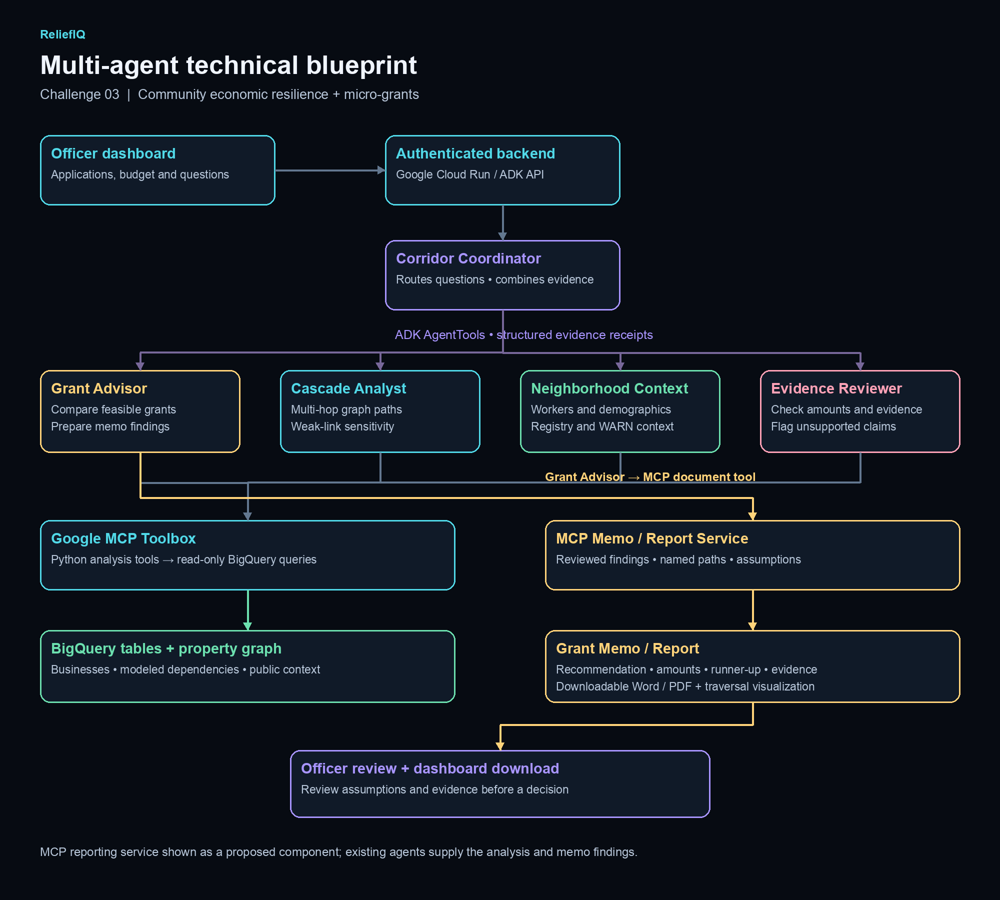

# ReliefIQ — technical blueprint

## Implemented analysis flow

The officer dashboard backend sends questions/scenarios to the Cloud Run ADK API.
`corridor_coordinator` delegates through ADK AgentTools and preserves structured evidence receipts.

| Specialist | Purpose |
| --- | --- |
| Grant Advisor | Compares full-gap funding portfolios and drafts a conditional Grant Memo |
| Cascade Analyst | Executes real multi-hop BigQuery property-graph traversals and sensitivity checks |
| Neighborhood Context | Retrieves modeled worker links, tract demographics, dated registry status and county WARN records |
| Evidence Reviewer | Checks budgets, identities, exposure counts, provenance and potentially unsupported wording |

Python tools communicate over MCP Streamable HTTP with Google's MCP Toolbox. Fixed read-only
queries access `a4i_econ` and `CascadeEconomy`. Grant comparisons include public-record evidence
and deterministic review findings. Public data source dates and match limits remain visible.

## Proposed reporting flow

Grant Advisor would send reviewed findings, amounts, named paths, alternatives and assumptions
to an MCP Memo / Report Service. That service would format a downloadable Word/PDF document
with traversal evidence and return the artifact to the dashboard for officer review.
This service is a proposed extension; the current agents produce memo text and structured evidence.
Neither document generation nor review means a grant is approved.

## Data and provenance

See the [data ERD](../../docs/data-erd.md) and [public-data notes](../../docs/public-data-integration.md).
Registry identities and public source records are real; supply and footfall connections are modeled.
Grant applications/cash gaps are supplied inputs, and demo financial scenarios are simulated.
WARN notices are county context without verified corridor-business or employer-block links.

## Diagram files

- [Dark PNG](reliefiq-architecture-dark.png), 2000 × 1800 pixels.
- [Editable Mermaid](reliefiq-architecture.mmd).
- `render_blueprint.py` recreates the PNG with Pillow and Arial fonts on macOS.
