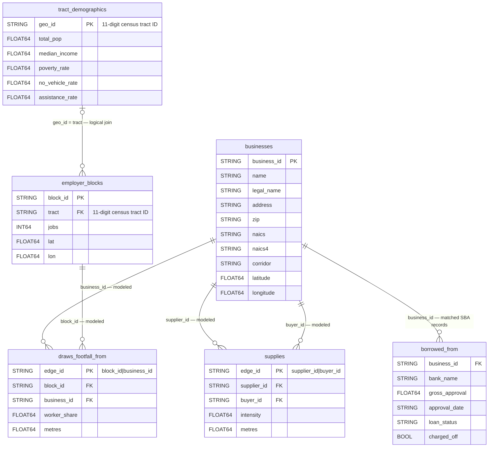
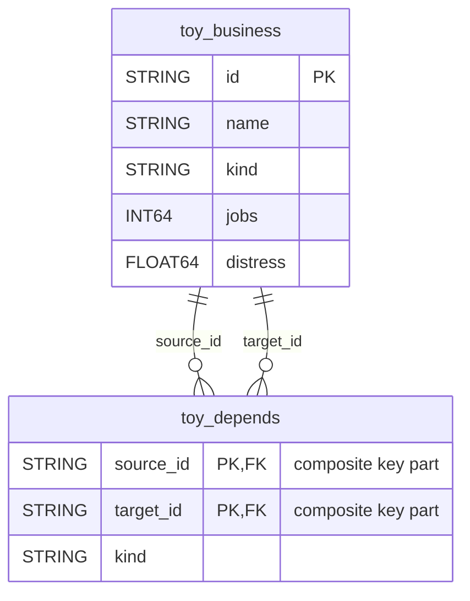

# Central Market data ERD

Dataset: `qwiklabs-gcp-04-029c15637557.a4i_econ` (BigQuery location `US`).
This diagram describes the loaded tables and logical joins. `PK` denotes an intended unique
identifier, including inline property-graph keys; `FK` denotes a logical reference. These labels
do not imply enforced BigQuery relational constraints. Types below follow notebook construction;
they are not a fresh live schema inspection. Row counts are from the previously recorded project reads.

## Table inventory and meaning

| Table | Recorded rows | Source and interpretation |
| --- | ---: | --- |
| `businesses` | 232 | Real San Francisco registry locations; `business_id` comes from stable `ttxid`. ZIP can represent a mailing address. |
| `supplies` | 994 | Modeled supplier → buyer edges using BEA input requirements, industry prefixes and proximity; not observed purchases. |
| `employer_blocks` | 122 | Real LEHD workplace job totals; coordinates approximate each block using its tract's internal point. |
| `draws_footfall_from` | 1,024 | Modeled employer-block → consumer-business connections; `worker_share` allocates block jobs among nearby consumer businesses. |
| `borrowed_from` | 4 | Real SBA source records matched to registry names/legal names within the city's ZIP prefix; linkage is not independently verified. All four recorded rows had `loan_status=EXEMPT`, `charged_off=False`. |
| `tract_demographics` | 7 | Real ACS tract estimates. Rates are fractions, not percent values; `total_pop` is stored as a float by notebook SQL. |

A business can have zero or many supplier, buyer, footfall and loan records. Each supply edge
references exactly one supplier and buyer; each footfall edge references one block and business.
The tract relationship allows missing demographic matches rather than assuming complete coverage.
Normalize tract identifiers to 11-digit strings with leading zeros when joining.

`borrowed_from` has no `loan_id`, `edge_id`, or declared unique composite key in the loader.
Do not assume `(business_id, bank_name)` uniquely identifies a loan. Lender names are attributes
in this table; there is no separately loaded `banks` entity.

There is no `tract` foreign key on `businesses`. A block's tract describes workplace context,
not a business's customer demographics. A direct business-to-tract mapping would require a
separate spatial join. There is also no corridor table: `corridor` is a business attribute.

Block jobs total 44,847 in the recorded load. These are not employment counts at the 232
businesses. `worker_share` is an allocated worker count, not a probability or a share of business revenue.
Loan approval amounts do not establish current cash gaps or grant needs.

## Property graph overlay

The implemented `CascadeEconomy` graph uses `businesses` as `Business` nodes and `supplies`
as directed `Supplies` edges: `supplier_id → buyer_id`. Its keys are `business_id` and `edge_id`.
The graph is metadata over these tables, not another copy of their rows.

The notebook's `LocalEconomy` example additionally shows `employer_blocks` nodes and
`DrawsFootfall` edges from blocks to businesses. That DDL is a proposed example, not evidence
that this expanded graph was deployed. Footfall and demographic queries can use the underlying
tables independently of the graph. No lender node graph has been implemented in this ERD.

## Separate illustrative data

These tables are fictional teaching examples, with no joins to the real corridor tables.

Recorded counts: 12 toy businesses and 11 toy edges. `ToyBlock` declares the composite edge
key `(source_id, target_id)` and direction source → target. The `kind` field labels supply or
footfall connections; it does not make these fictional links observations.

## Sources

- [Loader notebook](../notebooks/c3_01_load_explore.ipynb): normalized business columns,
  supply/footfall construction, SBA matching, ACS projection, load steps, and toy graph DDL.
- [Implemented graph DDL](../agent/cascade_analyst/queries.py).
- [Recorded deployment/data verification](../agent/VERIFICATION.md).
- [Project data notes](../data/README.md).

Applicant budgets, requested grants, cash gaps, operating horizons, and evidence provenance
are agent inputs. They are not additional persisted tables in the loaded dataset.
